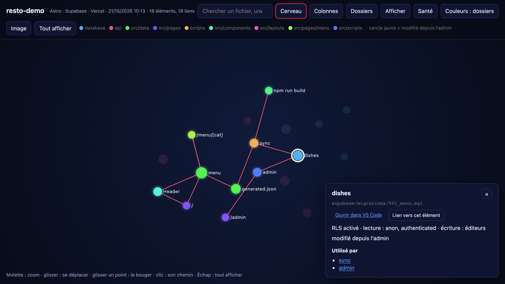
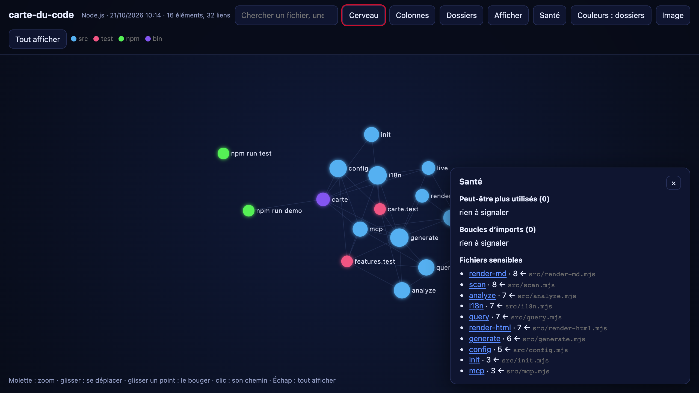
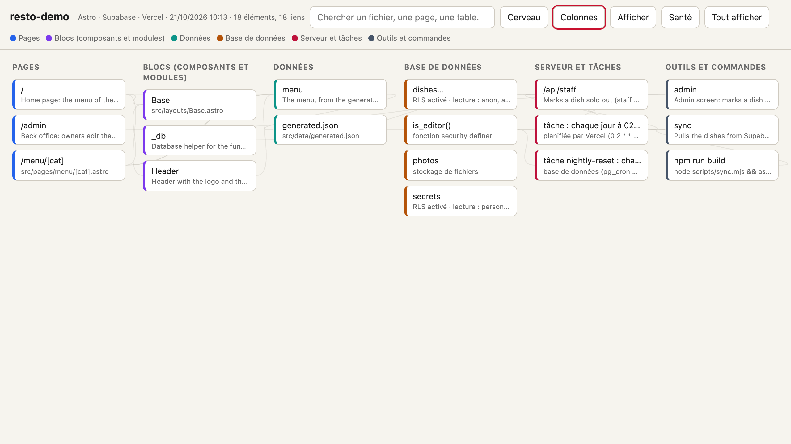

# carte-du-code

**La carte de ton code en une commande.** Pages, composants, données, base de données, serveur et outils, avec *qui utilise quoi* :
un fichier Markdown que ton assistant IA (Claude Code, Cursor, Copilot…) lit avant de fouiller ton projet, et un graphe « cerveau » à explorer dans le navigateur.

Zéro dépendance · rien ne sort de ta machine · 0,2 s sur un site, 0,3 s pour 1 500 fichiers.

**[Voir la démo en ligne](https://minh54500.github.io/carte-du-code/)** (la carte de ce dépôt et de ses 8 mini-projets de test).



## Pourquoi

Un assistant IA qui découvre un projet ouvre des dizaines de fichiers pour comprendre où est quoi : c'est lent et ça consomme son contexte. `carte` lui donne le plan en une lecture. Pour toi, c'est une vue claire de ton architecture : quelle page lit quelle table, ce qui casse si tu touches à un fichier, ce qui est modifiable depuis l'admin.

## Installer

Il faut **Node.js 18.17 ou plus**. Aucune autre dépendance.

```bash
# directement depuis GitHub, sans rien installer
npx github:minh54500/carte-du-code

# ou pour l'avoir partout
git clone https://github.com/minh54500/carte-du-code.git
cd carte-du-code && npm link        # la commande « carte » est disponible dans tous tes dossiers
```

## Utiliser

```bash
carte                  # génère docs/carte/ dans le dossier courant
carte mon-projet --open
carte live             # carte en direct : redessinée à chaque fichier enregistré, la page se recharge seule
carte init             # la refait après chaque commit et garde docs/carte/ hors de git
carte init --claude    # + ajoute à CLAUDE.md la consigne de lire la carte avant de chercher
carte mcp              # serveur MCP : ton assistant interroge la carte directement (voir plus bas)
```

Trois fichiers dans `docs/carte/` :

| Fichier | Pour qui | Contenu |
|---|---|---|
| `carte-du-code.md` | ton assistant IA | chaque élément, son rôle (son premier commentaire), → ce qu'il utilise, ← qui l'utilise |
| `carte-du-code.html` | toi | le graphe : vue **Cerveau** (réseau, couleurs par dossier) ou **Colonnes** (pages → blocs → données → base → serveur → outils), recherche, clic = chemin complet, export PNG |
| `carte-du-code.json` | tes outils | les nœuds et les liens, la santé et les changements, pour d'autres scripts ou agents |

Sur un gros projet (plus de 400 éléments), le Markdown est condensé par dossier et le détail de chaque fichier part dans `carte-du-code-detail.md`.

### Ce que montre le graphe

- **Cerveau** (réseau, couleurs par dossier) ou **Colonnes** (pages → blocs → données → base → serveur → outils). Clic sur un élément : tout son chemin s'allume.
- **Dossiers** : sur un gros projet, une bulle par dossier ; un clic ouvre le dossier.
- **Santé** : les fichiers que plus personne n'importe, les boucles d'imports (A utilise B qui utilise A), les fichiers sensibles dont dépendent le plus d'autres.
- **Changements** : ce qui est apparu ou a disparu depuis la carte précédente (cercle vert = nouveau).
- **Afficher** : masquer une colonne ou les tests. **Ouvrir dans VS Code** sur chaque fichier, et un lien direct vers chaque élément (`#n=…`) à partager.





## Ce qu'elle reconnaît

| Domaine | Reconnu |
|---|---|
| Sites et apps | Astro, Next.js (app et pages router, groupes, layouts, route handlers), SvelteKit (layouts, fichiers `load`), Nuxt (layouts, `server/api`), React Router, Vite, React, Django, HTML simple |
| Monorepos | workspaces npm, yarn et pnpm : un paquet importé par son nom mène à son fichier, chaque route porte le nom de son app |
| Imports | JS/TS (`import`, `require`, `import()`, alias `@/`, `paths` du tsconfig, `./x.js` → `x.ts`), `<script src>`, Python (`import`, `from … import`), Swift (types partagés), scripts shell qui lancent un autre fichier |
| Base de données | migrations SQL / Supabase (tables, RLS, politiques lecture/écriture, fonctions `security definer`, boucles `format()`, `pg_cron`, stockage), modèles Prisma, Django, Drizzle, Mongoose, collections Firestore, appels `.from()`, REST, `rpc()`, `prisma.x` |
| Serveur | fonctions Vercel (`api/`), Netlify, Supabase Edge, endpoints Astro/SvelteKit, routes Express, Fastify, Flask, FastAPI, appels `fetch('/api/…')` |
| Tâches et outils | crons Vercel, `pg_cron`, scripts `package.json`, scripts qui écrivent des données générées |
| Réglages | noms des variables d'environnement (jamais leurs valeurs), en-têtes et redirections Vercel, `netlify.toml`, `wrangler.toml`, `_headers` |

Le rôle de chaque fichier est lu dans **son premier commentaire** : un `// Ce fichier fait…` en haut de chaque fichier rend la carte bien plus parlante.

## Avec Claude Code (ou un autre assistant)

**Le fichier.** `carte init --claude` ajoute à `CLAUDE.md` la consigne de rafraîchir puis lire la carte avant de chercher dans les fichiers. Elle se refait en moins d'une seconde : l'assistant l'a toujours à jour.

**Les questions directes (MCP).** Plutôt que de lire toute la carte, l'assistant pose sa question et reçoit juste la réponse :

```bash
claude mcp add carte -s user -- carte mcp     # Claude Code, une fois pour tous tes projets
```

Pour Cursor ou un autre outil MCP : la commande `carte mcp` (ou `npx github:minh54500/carte-du-code mcp`), en stdio.

| Outil | Réponse |
|---|---|
| `overview` | la pile, les pages, les tables, le serveur, les fichiers les plus utilisés, la santé |
| `search` | les éléments qui contiennent un mot |
| `item` | un élément : son rôle, ce qu'il utilise, qui l'utilise, combien en dépendent |
| `who_uses` | qui l'utilise ; avec `deep`, tout ce qui peut casser si on le change |
| `uses` | ce qu'il utilise, directement ou non |
| `path` | la chaîne entre deux éléments, ex. page → données → script → table |
| `health` | fichiers inutilisés, boucles d'imports, fichiers sensibles |

Chaque projet est relu à la demande (pas de fichier à générer) ; le paramètre `project` permet d'en viser un autre.

## Réglages

Ligne de commande : `--out <dossier>`, `--lang fr|en`, `--ignore "<motif>"` (répétable), `--no-json`, `--open`, `--port <n>`, `--quiet`.
Ou un fichier `.carterc.json` à la racine du projet :

```json
{ "lang": "en", "out": "docs/carte", "ignore": ["legacy/**", "*.generated.ts"], "title": "Mon projet" }
```

Les dossiers lourds (`node_modules`, `dist`, `build`, `.next`, `venv`…) sont toujours ignorés, et dans un dépôt git la carte respecte `.gitignore`.

## Confidentialité

Tout se passe sur ta machine : aucune requête réseau, aucune IA, aucun compte. La carte contient des noms de fichiers, de tables et de variables, jamais de valeurs. Elle décrit la structure de ton projet : ne publie pas celle d'un projet privé.

## Limites

L'analyse lit le code par motifs, sans le compiler : un import dont le chemin est calculé à l'exécution, ou une table nommée dans une variable, n'apparaît pas. Les liens restent fiables pour les écritures courantes ; les tests (`npm test`) couvrent quatre projets types.

## Développer

```bash
npm test                 # 17 tests sur 8 mini-projets (Astro + Supabase, Next.js, Flask, Express + Prisma, monorepo, Django, SvelteKit, Nuxt)
npm run demo             # la carte du mini-projet Astro, ouverte dans le navigateur
```

Vérification automatique sur GitHub : copier `ci/github-actions-test.yml` dans `.github/workflows/` (depuis le site GitHub : *Add file → Create new file*, nom `.github/workflows/test.yml`).

`bin/carte.mjs` (commande) · `src/scan.mjs` (fichiers) · `src/analyze.mjs` (nœuds et liens) · `src/query.mjs` (questions, santé, changements) · `src/render-md.mjs` · `src/render-html.mjs` (graphe, Barnes-Hut) · `src/mcp.mjs` · `src/live.mjs` · `src/init.mjs` · `src/i18n.mjs`.

---

## English

**Your project's code map in one command**: pages, components, data, database, server and tools, with who uses what. A Markdown map and an MCP server for your AI assistant, and a "brain" graph to explore in the browser. Zero dependencies, nothing leaves your machine. [Live demo](https://minh54500.github.io/carte-du-code/).

```bash
npx github:minh54500/carte-du-code --lang en    # or: git clone … && npm link, then `carte --lang en`
carte live          # live map, redrawn on every save
carte init --claude # refresh after every commit + tell Claude Code to read it first
claude mcp add carte -s user -- carte mcp   # let Claude Code ask the map: overview, item, who_uses, uses, path, search, health
```

Outputs in `docs/carte/`: `carte-du-code.md` (for AI assistants, condensed by folder on big projects), `carte-du-code.html` (brain, columns and folder views, search, click to light a whole chain, code health, changes since last run, filters, open in VS Code, PNG export), `carte-du-code.json`. Recognises Astro, Next.js, SvelteKit, Nuxt, Vite, React, Django, Python, Swift, shell scripts, monorepo workspaces, Supabase / SQL migrations with RLS, Prisma, Drizzle, Mongoose, Firestore, Vercel / Netlify / Cloudflare, Express, Fastify, Flask and FastAPI. Settings: `--lang`, `--out`, `--ignore`, or `.carterc.json`.

## Licence

MIT © BUI VAN Minh
